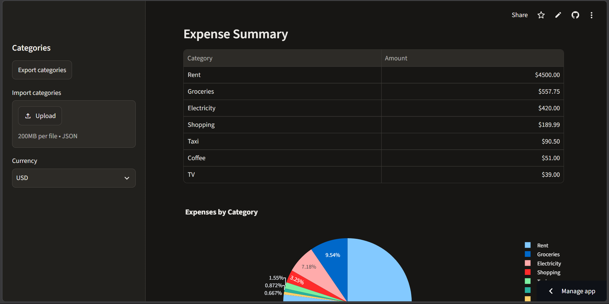

# Spendwise


A personal finance dashboard: upload a bank CSV, categorise your transactions, and see where your money goes.

**Live app:** [spendwise-nathani.streamlit.app](https://spendwise-nathani.streamlit.app/). No CSV handy? Click **Try demo data**.

The free hosting sleeps when nobody has visited for a while. If you see a wake-up button, click it and allow about a minute.



> **Privacy:** uploaded files are processed in memory and never saved. Your categories live only in your browser session; export them to keep them between visits.

## Features

- Upload a bank statement as a CSV file, or try three months of demo data with one click
- Assign categories in an editable table; changing one transaction updates every matching one
- Expense summary table and chart by category
- Total payments received (credits)
- Currency detected automatically from a `Currency` column or from symbols in the amounts (₦, $, €, £), with a manual selector (USD, NGN, EUR, GBP, AED)
- Export and import your categories as a JSON file

## CSV format

| Column | Example | Notes |
|---|---|---|
| `Date` | `05 Jan 2026` | Day, short month name, year |
| `Details` | `Carrefour` | Merchant or description |
| `Amount` | `"12,500.00"` or `"₦245.60"` | Quote amounts that contain commas |
| `Debit/Credit` | `Debit` | `Debit` for spending, `Credit` for money in |
| `Currency` | `NGN` | Optional |

Example:

```csv
Date,Details,Amount,Debit/Credit
02 Jan 2026,Salary,"12,500.00",Credit
03 Jan 2026,Carrefour,"245.60",Debit
05 Jan 2026,Uber,"38.00",Debit
```

## Run locally

Requires Python 3.13.

```powershell
git clone https://github.com/Nathani21/spendwise.git
cd spendwise
python -m venv .venv
.venv\Scripts\Activate.ps1
pip install -r requirements.txt
streamlit run main.py
```

On macOS or Linux, activate the environment with `source .venv/bin/activate` instead.

## Run the tests

```powershell
pip install pytest
python -m pytest
```

## How it works

- **`transactions.py`** holds all the logic (parsing, currency detection, categorising, import/export validation) as plain functions with no Streamlit imports, so it can be unit tested
- **`main.py`** is the Streamlit interface and keeps per-visitor state in the session
- **`test_transactions.py`** covers the logic with pytest
- **CI:** GitHub Actions runs the tests on Ubuntu with Python 3.13 for every pull request, and `main` is protected so a failing check blocks the merge
- **Deployment:** Streamlit Community Cloud redeploys the live app on every merge to `main`

## Roadmap

- Month filter and spending trends over time
- Budgets per category with progress bars
- Smarter matching, so partial names like `UBER *TRIP 123` match `Uber`
- v2: rebuild with a FastAPI backend and a Next.js frontend, with accounts

## Credits

Started from a Streamlit finance tutorial, then fixed, tested and extended.

## License

[MIT](LICENSE)
